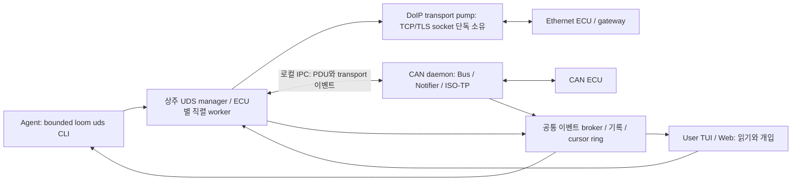

# UDS R1 독립 초안 — Sol: 라이브러리·타이밍·시뮬레이션 근거

## 핵심 루프

**우선순위: [최우선 원칙](../02-core-principle.md) 및 [긴급 추가 지시](tasks/r1-addendum-core.md) > 공통/UDS 브리프.** 계획 문서이며 제품 구현은 없다. 아래 CLI·화면·성능 수치는 명세 제안이다. 별도로 “측정”이라고 쓴 값만 스파이크 관측값이다. 작성/조사일: 2026-11-09 KST, 패키지·커밋 시각은 UTC. R1 당시 타팀 합의는 미완료다.

| 4요소 | UDS 구현 제안 | 최초 수용 증거 |
|---|---|---|
| 직접 접근 | 에이전트가 `loom uds connect --doip …` 또는 `--can …`를 호출하면 상주 UDS 관리자가 실제 ECU 연결을 생성한다. DoIP 소켓은 UDS 데몬, CAN 장치·ISO-TP는 CAN 데몬이 단독 소유한다. 사람이 별도 진단 프로그램을 열 필요가 없다. | M1은 동일 경로의 가상 ECU, M2는 실제 장비에서 에이전트 명령만으로 연결 |
| 읽기 | 경계 있는 `read-did`, `dtc list`, `raw`, `wait-for`, `trace --tail`을 통해 원시 응답과 디코드·NRC·타이밍을 받는다. | `22 F1 90 → 62 F1 90 + VIN`을 에이전트 JSON과 사용자 화면에서 동일 transaction ID로 확인 |
| 쓰기 | 에이전트가 동일 세션의 `write-did`, session/reset/routine 등을 위험 정책 안에서 실행한다. raw에도 같은 정책을 적용한다. | M1 가상 ECU의 쓰기 가능한 DID `F1A0`에 `2E F1 A0 01`을 보내고 후속 읽기로 값 변경 확인 |
| 사용자 실시간 표시·개입 | CLI와 사용자 TUI/웹은 **같은 상주 세션의 같은 이벤트 스트림**을 구독한다. agent/user/device 출처와 실제 송수신을 표시하고 사용자가 요청 전송·폴링 정지·제어권 획득 가능. 뷰어는 나중에 열어도 현재 상태+연속 스트림에 즉시 합류한다. | M1에서 agent 전송→응답→라이브 행 표시→user 전송→agent가 변경값 재확인까지 한 번에 시연 |

**실시간 목표(미측정 제안):** 정상 운용 시 데몬이 ECU 응답을 수신한 시각부터 사용자 TUI/웹 렌더 완료까지 p95 ≤100 ms, p99 ≤200 ms. P2 판정과 화면 지연을 별도 계측한다. 초기 정상 운용 예산은 세션 20개, 합계 100 transaction/s; 한 ECU의 동시 요청은 항상 1개다. 고부하 1,000 transaction/s 재생·연속 pending·대량 transfer에서는 정확한 감사 기록을 우선하고 UI는 20 Hz로 배치/집계한다. 드롭·백로그·집계 개수와 시각을 표시하며 “연결됨”과 “최신 데이터임”을 구분한다(§5·§6·§9). 이는 현재 달성한 수치가 아니다.

## 1. 범위 / 비범위

### 1.1 채택 제안

- Python ≥3.11, `uv`, `loom.uds` 패키지. 동기 `udsoncan` 서비스 계층을 상주 세션 worker에서 사용하고 IPC/뷰어 이벤트 루프는 별도로 둔다.
- DoIP: IPv4 UDP 13400 차량 식별·announcement, TCP 13400 routing activation, 물리 ECU 논리 주소 선택, 연결/재연결 상태 표시. TLS 3496은 검증된 `ssl.SSLContext` 경로를 M2에서 제공하며, upstream의 `use_secure=True`를 그대로 제품 기능으로 간주하지 않는다(§7.3).
- CAN-TP: CAN 데몬이 ISO-TP를 호스팅하고 UDS에는 완전 PDU+타임스탬프를 전달한다. normal 11/29bit부터 시작해 normal-fixed/extended/mixed, CAN FD를 M2에서 추가 검증한다. functional은 허용된 단일 프레임 읽기와 알려진 응답자 그룹만 후순위 지원한다.
- 서비스: `0x10/11/14/19/22/27/2E/2F/31/3E`를 단계적으로 지원한다. seed-key는 사용자가 제공한 플러그인만 사용한다. 모델이 알고리즘을 추정하거나 반복 시도하지 않는다.
- M1: 가상 ECU에서 연결·읽기·실제 값 변경·라이브 TUI·사용자 개입을 완성한다. JSON/YAML DID 정의는 최소 스칼라/ASCII만 먼저 지원한다.
- 후순위: ODX/PDX, DTC 고급 디코드, 웹 시각화, 시나리오, multi-ECU 기능 주소 수집, OEM 플래시. 모두 핵심 루프가 동작한 뒤 추가한다.

### 1.2 플래시 범위 판단

**선택: 범용 실차 플래시는 초기 릴리스 비범위.** `0x34 RequestDownload / 0x36 TransferData / 0x37 RequestTransferExit`의 패킷·진행률·결함 주입은 가상 ECU에서 M3에 검증한다. 실제 ECU는 OEM 프로필, 검증 이미지, 전원/복구 절차가 확보된 별도 마일스톤에서만 허용한다.

`udsoncan`에 서비스 API가 있어도 완성된 flasher를 뜻하지 않는다. `0x74`의 `maxNumberOfBlockLength`는 전송 블록 전체 길이이므로 일반 `0x36`의 SID 1바이트+sequence counter 1바이트를 뺀 데이터 크기를 계산하고, CAN 데몬 max PDU·DoIP 허용 payload·로컬 메모리 상한과 함께 제한해야 한다. counter는 8bit로 순환하며, 재전송/중복 블록 처리는 OEM 계약에 따른다. DFI의 압축/암호화 식별자, ALFI의 주소/길이 폭, 메모리 맵, erase/verify routine, checksum/서명·컨테이너·rollback은 OEM별이다. 미확인 형식의 이미지로 raw 전송하는 우회도 막는다. 서비스 형식 근거: [RequestDownload](https://udsoncan.readthedocs.io/en/latest/udsoncan/services.html#requestdownload-0x34), [서비스 구현](https://github.com/pylessard/python-udsoncan/tree/v1.26.1/udsoncan/services).

대안은 사용자 제공 flasher를 외부 작업으로 호출하는 방식이나, 동일 대상 소유권·감사·실시간 진행 이벤트를 만족하기 전에는 Loom 지원으로 표시하지 않는다.

## 2. 사용 시나리오

### 2.1 에이전트 관점

1. IP/논리 주소가 주어진 벤치 ECU를 `connect --doip 192.0.2.10 --la 0x1001 --timeout 3s`로 열고 `read-did F190 --timeout 2s --json`을 실행한다. 사용자는 연결과 VIN 요청/응답을 같은 세션에서 본다. 주소는 문서 예시다.
2. `connect --can ch0 --tx 0x7E0 --rx 0x7E8` 후 `dtc list --status-mask 0xFF --timeout 3s`로 고장을 확인한다. DTC 삭제는 별도 preview/grant가 있을 때만 실행한다.
3. 가상 ECU에서 `write-did F1A0 --hex 01` 후 `read-did F1A0`로 변경을 확인한다. 실차에서도 동일 API를 쓰되 대상·DID·바이트에 묶인 쓰기 허가가 필요하다.
4. `poll F40D --period 200ms --duration 30s --max-samples 150`을 실행하고, 응답이 늦으면 겹쳐 보내지 않고 스킵 횟수와 실제 주기를 보고한다. 사용자가 정지하면 agent도 job 상태에서 이를 확인한다.

### 2.2 사용자 관점

1. 에이전트가 이미 사용하는 `ecu1`에 TUI로 접속하면 최신 상태와 bounded tail 뒤에 **현재 라이브 요청/응답**이 이어진다. 연결이나 ECU를 다시 열지 않는다.
2. VIN 행을 펼쳐 raw hex·NRC/pending·transport RTT·화면 지연을 확인하고 `r` 키로 다른 DID를 읽는다. user 요청은 ECU 직렬 큐에 들어가고 에이전트 화면에도 같은 결과가 보인다.
3. 반복 폴링 도중 `s` 키로 job을 멈춘다. “현재 요청 대기 중/다음 요청 중지” 상태와 실제 정지 완료가 구분된다. 쓰기 중이라면 이미 전송된 동작을 취소했다고 표시하지 않는다.
4. 쓰기 preview의 ECU 주소·현재 세션·변경 바이트를 보고 한 번 허가한다. 허가가 소모되면 다시 읽기 전용 상태가 화면에 표시된다.

### 2.3 M1 종단 간 시나리오와 화면

아래는 **예정된 제품 명령/화면**이며 현재 존재하는 CLI가 아니다. 시뮬레이션 구성에는 read-only `F190=LOOMSIM0000000001`, writable `F1A0=u8`가 있다.

```text
# agent — sim start는 CAN 데몬의 virtual 채널과 ECU 노드를 함께 준비한다.
loom uds sim start --profile bench --transport can --name bench --timeout 3s
loom uds connect --can bench.can0 --tx 0x7E0 --rx 0x7E8 --name ecu1 --timeout 3s
loom uds read-did F190 --session ecu1 --timeout 2s --json

# user — 같은 세션에 합류, 무한 agent stdout 명령이 아닌 사용자용 대화형 TUI
loom uds view --session ecu1 --tui
```

```text
Loom UDS  ecu1 [CAN bench.can0 7E0→7E8]  LIVE  seq=413  lag=24 ms
control: shared queue | session: default | TP: off | writer: none
time         txn    origin   dir     service                  result
12:00:00.010  tx31   agent    tx      22 F190 ReadDID           sent
12:00:00.013  tx31   device   rx      62 F190 …                 VIN=LOOMSIM0000000001
                                     ECU→render=24 ms (例)    P2/start=1.2 ms (例)
[r] Read DID  [w] Preview Write  [s] Stop poll  [t] Take control  [q] Detach
```

agent는 `preview write-did F1A0 --hex 01`→사용자의 시뮬레이터 전용 grant 발급→`write-did … --grant <id>`를 실행하고 `6E F1 A0` 및 후속 `62 F1 A0 01`을 확인한다. 사용자가 TUI에서 `w`로 같은 DID를 `02`로 바꾸면 `origin=user` 요청/`origin=device` 응답이 agent의 `trace --tail 10`에도 보이고, agent의 다음 읽기는 `02`를 반환한다. 이 왕복이 M1의 **읽기·쓰기·동시 가시성·개입** 수용 테스트다. 실시간 수치는 정상 부하 1,000회 측정의 p95≤100 ms/p99≤200 ms로 판정한다. 화면 예시 수치는 측정값이 아니다.

## 3. 아키텍처 (프로세스·데이터 흐름·타이밍)



### 3.1 소유권과 사용자 개입

- `loom daemon` 감독 아래 UDS 관리자는 상주한다. DoIP는 이 프로세스만 열고, CAN은 CAN 데몬만 연다. `udsoncan.Client`를 매번 CLI에서 열어 실제 ECU와 직접 통신하는 구조를 사용하지 않는다. CLI의 종료는 세션 종료가 아니다.
- 세션 키는 `(transport, physical_device, tester_source, ecu_target, addressing)`다. CAN 주소 키는 단순 tx/rx ID뿐 아니라 extension/source/target address를 포함한다. 같은 ECU에 두 CLI·뷰어가 붙어도 연결과 요청 큐는 하나다. 독립 세션 별칭으로 동일 ECU 잠금을 우회하지 못한다.
- 한 ECU당 outstanding UDS request 1개. 사용자 read는 직렬 큐에 추가하고, `take-control`은 다음 트랜잭션 경계에서 agent/poll job을 일시 정지한다. 위험 동작의 active grant가 있으면 대상·소유자 정보를 보여 주고 새 전송을 차단한다. 이미 전송한 쓰기를 “취소 성공”으로 보고하지 않는다.
- 같은 장치 raw CAN 송신도 진단 tx ID 예약과 연결한다. 경고만으로는 충돌을 막지 못하므로 활성 ISO-TP 채널과 충돌하는 raw 송신은 기본 차단을 CAN 팀에 요청한다.
- transport 수신과 FC는 기록·디코더·UI backpressure와 분리한다. `udsoncan` 동기 호출은 worker에서 수행하고 승인/상태/뷰어 스트림은 계속 동작한다.

### 3.2 CAN 데몬 IPC와 BaseConnection

`udsoncan.connections.BaseConnection`의 `open`, `close`, `is_open`, `specific_send`, `specific_wait_frame`, `empty_rxqueue` 6개 메서드로 PDU IPC를 감쌀 수 있다. 실제 별도 프로세스 Pipe 어댑터 스파이크가 성공했다(§9.2). 제품에서는 `LoomCanPduConnection`을 UDS 관리자의 worker에 두고 CAN Bus/ISO-TP를 만들지 않는다. 공식 근거: [Connection 확장 계약](https://udsoncan.readthedocs.io/en/latest/udsoncan/connection.html#defining-a-new-connection), [v1.26.1 소스](https://github.com/pylessard/python-udsoncan/blob/v1.26.1/udsoncan/connections.py).

`specific_send`는 **accepted 큐 응답이 아니라 tx_done/tx_error까지** 기다린 뒤 반환한다. `specific_wait_frame`은 세션 epoch와 request ID에 맞는 PDU를 deadline 안에서 받으며 NRC `0x78`도 그대로 위로 전달한다. `empty_rxqueue`는 라이브 기록을 삭제하지 않고 이 요청의 소비 큐만 정리한다. stale/unsolicited PDU도 이벤트·감사에는 남긴다.

### 3.3 P2/P2*, IPC 지연과 재조립

**50 ms / 5,000 ms는 계획용 ECU 프로필 값이며 모든 ECU의 강제 고정값이 아니다.** `0x50` 세션 응답 또는 OEM 설정으로 실제 P2Server/P2*Server를 확보한다. udsoncan 기본값은 P2=1 s, P2*=5 s, request_timeout=5 s다. `use_server_timing`과 NRC `0x78` 처리를 제공하지만, 응답을 완전 PDU로 받으므로 버스의 첫 프레임 시각을 자동 해석하지 않는다. [공식 client 설정](https://udsoncan.readthedocs.io/en/latest/udsoncan/client.html#configuration), [요청 루프 소스](https://github.com/pylessard/python-udsoncan/blob/v1.26.1/udsoncan/client.py).

| 구간 | 제안 예산/방법 | 판단 |
|---|---|---|
| CLI 요청→UDS 큐 | 큐 대기 별도 표시, 큐 상한 32/ECU | P2에 숨겨 넣지 않는다. job 전체 deadline에는 포함 |
| UDS↔CAN 데몬 제어 IPC | 로컬 왕복 p99≤5 ms 목표 | Pipe 측정 p99=2.003 ms, 최대10.374 ms. JSON/WS의 실측은 아직 없다 |
| CAN 데몬 PDU 이벤트 전달 | p99≤5 ms 목표, 과부하 이벤트 발행 | xteam의 ≤10 ms 제안보다 여유를 확보하는 초기 목표. 보장은 M1 계측 후 결정 |
| ECU P2 | 예:50 ms + 명시적 transport/client allowance | 장치 TX 완료→응답 첫 프레임의 시간으로 독립 판정 |
| ECU P2* | 예:5,000 ms, 매 `0x78` 후 다음 응답 대기 | 반복 pending도 총 deadline과 최대 횟수로 제한 |
| 응답 재조립 | 첫 프레임→완전 PDU는 ISO-TP N_Cr 및 별도 P6/완료 상한 | 긴 응답은 50 ms를 넘길 수 있어 P2와 구별 |

**판정 한계:** `_xteam` v0.1의 “완전 PDU 수신 때 first/last 시각 보고”만으로는 런타임 타임아웃을 해결하지 못한다. timely FF 뒤에 CF가 50 ms 이상 이어지면 기본 `Client.wait_frame(P2)`는 완성 전에 timeout할 수 있다. `rx_start {req_id, first_frame_ts, expected_length}` 이벤트와 `tx_done`이 필요하며, 상주 transaction runner가 first-response/P2·pending/P2*와 complete-PDU 수신 상한을 분리해서 감시해야 한다. udsoncan에 넘길 완료 대기 예산은 길이·N_Cr·전체 deadline 안에서 계산하고, 서버 타이밍 자동 덮어쓰기는 이 runner와 충돌하지 않게 설정한다. 라이브러리 timeout을 늘리는 것만으로 P2 적합성을 주장하지 않는다. **이 통합은 미검증이며 M2의 장문 응답·late FF 수용 게이트**다. 최소 M1은 짧은 응답으로 제한하되 그 한계를 표시한다.

제안 계산 예: IPC 제어+이벤트 전달을 각 5 ms 이내로 잡으면 ECU P2 50 ms에 대해 사용자 관측 대기는 약60 ms+응답 재조립이다(추정). ECU 자체 P2 예산을 IPC에 빼앗기지 않도록 데몬 timestamp로 분리 계측한다. monotonic은 같은 호스트/부팅 epoch일 때만 비교하고 HW clock 변환 오차를 기록한다. timeout 결과도 지연 도착한 이벤트로 성공으로 바꾸지 않는다.

NRC `0x78`은 실패 완료가 아니라 pending 이벤트다. 기본 job 총 deadline 30 s, 읽기 2 s, routine은 프로필별 최대120 s를 제안하며 전부 사용자에게 보인다. udsoncan `request_timeout`은 pending으로 리셋되지 않고 `conn.send()` 이후 대기에 적용되므로, transport 연결/송신/ACK/큐 대기까지 포함하는 외부 monotonic deadline이 추가로 필요하다. 제품은 무제한 `request_timeout=None`을 노출하지 않는다.

### 3.4 FC/STmin, TesterPresent

- FC/CF/BS/N_Bs/N_Cr는 CAN 데몬 내부 처리. `NotifierBasedCanStack`을 Bus의 공통 Notifier에 붙여 다른 구독자의 `recv()` 큐를 소모하지 않는다. PDU IPC는 FC 경로에 들어가지 않는다. [can-isotp v2 설명](https://can-isotp.readthedocs.io/en/latest/), [파라미터](https://can-isotp.readthedocs.io/en/latest/isotp/implementation.html).
- FC 응답 지연은 정상 벤치에서 FF 수신→FC 송신 p99≤2 ms를 **초기 목표(추정·미측정)**로 제안하고 실제 상대의 N_Br/N_Bs 설정 안에서 검증한다. N_Bs 기본1,000 ms를 근거로 늦은 FC가 괜찮다고 판단하지 않는다. TX driver enqueue와 wire 전송 시각을 구분하며 고부하 지터는 HW 수용표에 남긴다.
- STmin 0x00–0x7F는 0–127 ms, 0xF1–0xF9는 100–900 µs. 순수 Python+일반 OS는 최악 지터를 보장하지 않는다. `override_receiver_stmin`은 기본 `None`으로 상대 요구를 준수한다. 바쁜 대기·Linux kernel ISO-TP는 별도 최적화 후보이며 실측 없이 µs 보장이라고 표기하지 않는다.
- 초기 params: 수신 blocksize=8, stmin=0, N_Bs/N_Cr=1,000 ms, max PDU=4,095 B, 패딩 없음(프로필로 변경), FC overflow/WAIT/wftmax 명시. 라이브러리 기본값과 다른 값은 effective config에 표시한다. CAN FD는 `tx_data_length`·BRS·상대 FD 능력을 함께 검증한다.
- **TesterPresent 스케줄러는 상주 UDS 관리자**가 소유한다. 예제 S3=5 s이면 idle 간격2 s, 마감 여유를 두고 `3E 80`(프로필 허용 시) 전송. 실제 S3는 OEM 프로필 값이다. CLI 종료/뷰어 detach에 따라 무심코 정지하지 않는다. 기본 session idle lease 60 s, 절대10 min, 명시적 갱신/닫기 제공; 남은 시간을 사용자에게 표시한다(제안).
- UDS in-flight 중에는 새 UDS 서비스나 TesterPresent를 임의로 끼워 넣지 않는다. pending 처리 중 keepalive 요구는 ECU 프로필에서 정한다. `nrc78_callback`에서 같은 Client를 재진입시키는 설계는 응답 혼선을 만들 수 있어 기본 사용하지 않는다. 장시간 동작 동안 세션 유지 가능 여부를 가상 ECU와 OEM에서 확인한다.
- `_xteam`의 CAN 데몬 periodic PDU는 채택 유보: UDS 큐·세션·lease를 모르는 무조건 주기 송신은 충돌 위험. CAN 팀이 제공하더라도 `idle_only`, in-flight inhibit, owner-death stop, 감사 이벤트, session lease가 계약에 포함되어야 한다. 관리자가 죽으면 keepalive 정지·채널 폐쇄하고 ECU S3 만료에 맡기며 reset을 자동 보내지 않는다.

### 3.5 DoIP 타이밍·다중 ECU·TLS

선택 버전의 [constants.py](https://github.com/jacobschaer/python-doipclient/blob/v1.3.0/doipclient/constants.py)에는 A_DoIP_Ctrl=2 s, A_PROCESSING_TIME=2 s, T_TCP_INITIAL_INACTIVITY=2 s, GENERAL_INACTIVITY=300 s, ALIVE_CHECK=500 ms가 있다. **라이브러리 상수 조사 결과이며, ISO 원문 전체 적합성 검증이나 모든 OEM의 요구값은 아니다.** [AUTOSAR R24-11 DoIP](https://www.autosar.org/fileadmin/standards/R24-11/CP/AUTOSAR_CP_SWS_DiagnosticOverIP.pdf)는 inactivity/alive timer와 상태 관리를 별도로 정의하므로 대상 프로필과 대조한다.

- UDP discovery 기본 한 번의 제어 대기2 s, 전체 명령3 s/응답100개 상한을 제안한다. `get_entity()`는 broadcast 후 첫 결과만 반환하므로 다중 차량 탐색은 별도 수집 루프가 필요하다. NIC를 지정하고 broadcast 범위를 제한한다. IPv6 multicast는 후순위 capability다.
- routing activation 응답(0x0006), DoIP ACK(0x8002), UDS positive response(0x62 등)를 별개 상태·이벤트로 다룬다. activation type 기본0x00, 0x01/0xE1 및 OEM 타입은 명시 프로필만 허용한다. 인증 요구/거부는 사용자에게 원인으로 표시한다.
- 하나의 gateway IP에 여러 target LA가 있을 수 있다. M2 기본은 target당 연결/worker를 직렬로 할당하되 gateway의 허용 socket 수·tester SA 중복 정책을 먼저 확인한다. 소켓 공유 fan-out은 후순위. doipclient가 다른 LA로 송신할 수 있다는 사실만으로 concurrent multi-ECU routing을 보장하지 않는다.
- **별도 transport pump**가 idle에도 읽고 alive check에 대응해야 한다. `doipclient`는 `read_doip()` 안에서 요청을 처리하며 독립 유지 스레드를 제공하지 않는다. 여러 스레드가 그 소켓을 각각 읽지 않도록 단일 수신 소유자와 타입/주소별 queue가 필요하다. 필요 시 작은 upstream 수정/호환 wrapper를 선택하고 비용을 M2에 반영한다.
- TLS는 Python `ssl`의 CA 검증·SAN/hostname 확인·client cert로 기술적으로 가능하다. 최소 TLS1.2, 허용 cipher/profile은 ECU별로 정한다. upstream은 `SSLContext.wrap_socket`에 server_hostname을 넘기지 않는 문제가 로컬에서 재현됐다(§7.3·§9). 검증을 끄는 우회 대신 SNI/검증 이름을 명시하는 어댑터와 테스트가 필요하다. TLS 핸드셰이크/activation deadline은 UDS P2와 별도다. [Python ssl](https://docs.python.org/3.14/library/ssl.html#ssl.SSLContext.wrap_socket).

## 4. CLI / API 명세 초안

### 4.1 CLI 계약

기본 출력은 사람이 읽는 결과, `--json`은 schema version이 있는 단일 JSON. 모든 agent 명령은 timeout·최대 레코드·최대 바이트를 가진다. interactive `view`만 사용자가 계속 열어 두는 화면이다. 세션 이름만으로 현재 대상이 모호하면 송신을 거부한다.

| 명령 | 핵심 인자 / 제한 | 결과 |
|---|---|---|
| `loom uds discover` | `--doip --interface en0 --timeout 3s --max-results 100` | VIN/EID/GID/IP/LA 후보. 임의 차량에 연결·진단하지 않음 |
| `connect` | `--doip IP --la HEX --sa 0x0E00 --activation 0x00 [--tls --ca FILE --server-name NAME]` 또는 `--can ch0 --tx HEX --rx HEX --addressing normal_11`, `--name`, `--timeout` | 상주 session ID, effective config, transport capabilities, viewer URL/attach 명령 |
| `status / disconnect` | `--session ID --timeout 3s` | 연결/세션/queue/TP/lease/마지막 이벤트, 닫기 결과 |
| `read-did` | `F190[,F1A0] --session ID --timeout 2s` | raw·decoded·단위·타이밍·DB hash |
| `raw` | `22F190 --session ID --timeout 2s --max-response-bytes 4095` | 서비스 파서/위험 정책을 거친 결과. unknown SID는 차단/명시 프로필 필요 |
| `dtc list / clear` | `--status-mask`, `--group`, `--grant` | status mask 원문·해석; clear는 위험 승인 필요 |
| `session / reset` | `--type`, `--grant` | ECU 상태 변경, 재연결은 별도 작업 |
| `security unlock` | `--level --provider NAME --grant --timeout` | seed/key 원문 기본 마스킹, 플러그인 결과 상태 |
| `preview write-did / routine / io-control` | 대상·서브기능·정확한 바이트 | 전송 없는 plan hash·위험·조건·grant 요구 |
| `write-did / routine / io-control` | `--grant TOKEN` + preview와 동일 인자 | one-shot job·감사 ID·최종/미확정 상태 |
| `poll / wait-for` | DID·조건, `--period`, `--duration/--timeout`, `--max-samples` | job ID와 bounded 요약/샘플; 폴링 중첩 금지 |
| `trace` | `--after CURSOR --tail 100 --timeout 2s --max-bytes 65536` | 연속 cursor·gap·다음 cursor |
| `view` | `--session ID --tui` 또는 후순위 `--web` | 같은 live stream + 사용자의 요청 입력/정지 |
| `job status / cancel / take-control` | job/session ID·timeout | 취소 요청/전송 중/완료를 구별 |
| `scenario run` (후순위) | YAML·`--dry-run --timeout --max-steps` | 조건/단계별 grant와 진행 이벤트, 임의 Python 실행 금지 |

```json
{"schema_version":1,"ok":true,"session_id":"ecu1","request_id":"tx31","result":{"sid":"0x22","did":"0xF190","value":"LOOMSIM0000000001","unit":null,"response_hex":"62F1904C4F4F4D53494D30303030303030303031","pending_count":0,"timing":{"roundtrip_ms":3.1,"p2_start_ms":1.2,"transport":"can-isotp"}},"cursor":413,"truncated":false}
```

위 예시의 수치는 명세 예시다. 오류는 `error.code`=`UDS_NRC/TRANSPORT_TIMEOUT/POLICY_DENIED/BUSY/DEADLINE/CANCEL_PENDING` 등과 NRC, retryable, `may_have_executed`를 담는다. exit code 제안: 0 성공, 2 인자, 3 transport/deadline, 4 NRC, 5 정책, 6 busy/cancel. `0x78`은 최종 exit4가 아니다. timeout 뒤 장치에 쓰기가 실행됐는지 불명확하면 `may_have_executed=true`이며 자동 재시도하지 않는다.

### 4.2 로컬 API와 세션 이벤트

공통 IPC는 **JSON-RPC 2.0 over loopback WebSocket**을 제안한다. 브라우저 접근이 가능하고 요청/이벤트를 묶기 쉽다. token·Origin 검증, 로컬 bind, request cap을 공통 계층에서 담당한다. 도메인 API는 전송 방식과 독립적으로 버전 관리한다.

```text
uds.connect(config, client_deadline_ms) -> session_id, capabilities, cursor
uds.request(session_id, service, params, origin, grant_id?, deadline_ms,
            idempotency_key) -> job_id, request_id
uds.job_get(job_id) / uds.cancel(job_id) / uds.take_control(session_id)
uds.subscribe(session_id, after_seq, filter, max_batch) -> snapshot + events
uds.disconnect(session_id)

# UDS→CAN: xteam v0.1를 기본으로 아래 보강 요청(§15)
isotp.open(addressing, tx_id, rx_id, params, owner) -> channel_id, epoch, effective_params
isotp.send(channel_id, req_id, pdu_hex, deadline_ms) -> accepted
event tx_done / tx_error / rx_start / rx_complete / rx_error / state
```

`accepted`는 ECU 실행 성공을 뜻하지 않는다. IPC idempotency는 같은 job을 반환할 뿐 transport 재전송을 하지 않는다. UDS wire protocol에는 request ID가 없으므로 timeout 후 늦은 응답은 이전 epoch로 격리하고, 미해결 ECU 채널은 drain/quarantine 후 재연결 또는 명시 회복 절차를 따른다. 같은 SID/DID를 즉시 재전송해 새 응답인 척 붙이지 않는다. functional 수집은 일반 단일응답 `Client`와 분리된 bounded 수집 job으로 설계한다.

## 5. 사용자 뷰어 UX

**M1은 TUI**: 상단에 물리 대상/LA·CAN ID, origin별 큐, 세션/보안·TP lease, 연결 및 stream lag. 중앙은 실시간 요청/응답/pending 트레이스, 하단은 Read/Preview Write/Stop/Take-control 입력. 사용자가 뷰어를 열면 `snapshot_seq`까지의 상태·최근100행을 받은 뒤 `seq>snapshot_seq`를 이어받아 중복/누락을 판별한다. 뒤늦게 열어도 새 연결을 만들지 않는다.

웹은 M1 이후 `loom.viz` 재사용: 좌측 ECU 목록, 중앙 거래 표, 우측 raw/decoded/허가 상태, 하단 numeric DID 플롯·문자/enum 상태 표. 사용자 송신도 동일 API/정책/감사를 사용한다. 가상 ECU·실차 badge와 대상 주소는 항상 보이며 raw 요청 입력창에도 동일하게 표시한다.

### 실시간성과 과부하

- `ecu_rx_mono_ns → broker_emit → viewer_receive → render_complete`로 지연을 나눠 수집한다. 브라우저/데몬 clock을 직접 빼지 않고 attach 시 offset/오차를 추정하거나 왕복 기반 지표를 함께 표시한다. HW timestamp→host 수신 오차도 별도다. 화면 예시의 24 ms는 목표 설명용이다.
- 빠른 DID poll: ECU당 한 요청만, 늦으면 다음 tick을 건너뛰고 `scheduled/skipped/actual_period` 표시. 기본 5 Hz, 가상 부하 외에는 프로필과 CAN 총부하 예산으로 상한 설정.
- `0x36` 대량 전송: 블록별 TX/RX 감사 기록과 정확한 byte count는 보존하고 UI는 50 ms 단위 진행률로 묶는다. 플래시 지원 전에는 simulator에서만 이 부하 시험을 실행한다.
- 연속 `0x78`, TesterPresent: UI는 “pending N회 / 마지막 시각 / 마지막 NRC” 및 TP 반복 접기. 원본이 삭제됐다고 오인하지 않게 “UI 집계 M건, 원문 기록 위치”를 표시한다. 최종 응답·실패·정지·승인 이벤트는 집계하지 않는다.
- 느린 뷰어 큐는 제안5,000행/5 MiB 상한, 매50 ms·최대200행 batch. 초과 시 `gap {first_seq,last_seq,count,reason}`를 보내고 `LIVE-DEGRADED`, lag, 마지막 수신 시각을 표시한다. 1,000 transaction/s에서는 UI 20Hz·plot downsample 및 dropped/aggregated 카운터가 유지되고 조작은 계속 응답해야 한다(목표≤200 ms).
- 기록 writer도 bounded queue를 사용한다. 디스크/감사 큐 고갈 시 새 장치 송신을 중단하고 오류를 띄우되 transport 수신/FC 처리는 계속한다. 수신 기록까지 놓쳤다면 capture loss 구간을 명시한다. 실제 장치 손실을 UI 다운샘플링으로 숨기지 않는다.
- 사용자 개입 우선순위는 emergency stop→take-control→수동 요청→agent/poll(현재 트랜잭션은 안전한 경계까지). stop 버튼을 눌렀을 때 queue 중지와 실제 장치 정지 여부를 따로 보여 준다.

## 6. 데이터 / 기록 포맷

공통 이벤트 `ts, domain, channel, dir, origin, payload`는 유지한다. 추가 공통 필드는 `schema_version`, `seq`, `session_id`, `connection_epoch`, `request_id`, `job_id`, `causation_id`를 제안한다. `origin` enum은 agent/user/device/script 그대로이고 `actor_id`, `purpose=tester_present` 등은 별도 필드로 둔다.

```json
{"schema_version":1,"seq":413,"ts":{"wall":"2026-11-09T14:00:00.013Z","mono_ns":1234567890,"clock_id":"host-boot-A"},"domain":"uds","channel":"ecu1","dir":"rx","origin":"device","session_id":"ecu1","connection_epoch":1,"request_id":"tx31","payload":{"event_type":"response","transport":"can-isotp","ecu":{"tx_id":"0x7E0","rx_id":"0x7E8"},"sid":"0x22","response_hex":"62F1904C4F4F4D53494D30303030303030303031","nrc":null,"decoded":{"F190":{"name":"VIN","value":"LOOMSIM0000000001","unit":null}},"pending_count":0,"db_sha256":"example","timing":{"tx_complete_ns":1231000000,"rx_start_ns":1232200000,"rx_complete_ns":1234000000}}}
```

위 예시는 형식 예시다. 전송 이벤트와 요청 이벤트는 송신 origin을 유지하고 ECU 응답은 device로 하되 `request_origin`/causation으로 연결한다. command queued/authorization/timeout 등의 관리 이벤트는 transport RX/TX와 혼동하지 않게 별도 event_type으로 기록한다. 공통 `dir`에 새 enum이 필요하면 메인 합의를 받는다.

- **기본 기록**: append JSONL 원시 이벤트 + 세션 manifest(패키지/장치/드라이버 버전, 주소/params, profile/DB hash, clock 정보, 민감 필드 정책). 요청·pending·최종·transport error가 각각 남는다. 레코드/파일 크기 상한, rotation 및 disk quota를 둔다. 정확한 기본 quota는 메인 결정.
- **파생 transaction**: 요청/응답을 묶어 service, NRC name, elapsed, pending_count, risk, grant audit reference를 가진 JSONL/Parquet로 export. 불완전 거래는 timeout/incomplete로 남기며 원문 seq를 참조한다. raw-event JSONL과 transaction JSONL은 `record_type`으로 구별한다.
- **시계열**: `{ts, series:"ecu1.F40D.vehicle_speed", value:42, unit:"km/h", quality:"valid", seq, request_id}` long form. NRC/누락은 0값으로 채우지 않고 null+quality로 남긴다. 문자열·enum은 상태 테이블로 보낸다. CSV는 raw/physical/단위·DB hash를 동반한다.
- CAN 원시 프레임·BLF/ASC/MF4는 CAN 팀 소유이며 UDS의 request_id·frame span·clock mapping으로 연동한다. ISO-TP FC도 가시성에서 빠지지 않는다. DoIP packet capture는 선택, 암호화된 wire capture와 진단 plaintext 감사의 차이를 설명한다.
- VIN/보안 seed/key·DID 개인정보는 기본 마스킹하고 접근 제어된 원문 저장은 명시 정책에 따른다. grant token 자체는 로그에 쓰지 않고 ID/hash와 승인 주체만 기록한다.

최소 DB 제안:

```yaml
schema_version: 1
ecu: bench
dids:
  F190: {name: VIN, type: ascii, length: 17, access: read}
  F1A0: {name: sim_mode, type: uint8, length: 1, access: read_write, unit: null}
  F405: {name: coolant_temp, type: uint8, length: 1, scale: 1, offset: -40, unit: degC, access: read}
```

F1A0/F405 정의는 벤치 예시이며 실차 표준값이라고 단정하지 않는다. endian·signed·bit width·길이를 명시하고 코드 실행형 YAML/custom expression은 기본 금지한다. multi-DID 응답 경계를 알 수 없는 unknown DID는 raw 단독 조회만 허용한다.

## 7. 라이브러리 실제 조사와 선택 근거

### 7.1 조사 방법과 최신 메타데이터

PyPI JSON의 `info.version`, 해당 release 파일 최초 upload 시각, `requires_python`, license metadata와 GitHub API의 **기본 브랜치 HEAD commit committer date**를 실제 조회했다. 아래 날짜는 UTC이며 `pushed_at`과 commit date를 혼동하지 않았다. 기본 브랜치 최신 커밋은 출시 wheel에 포함된 커밋이라는 뜻이 아니다. 보관본: [pypi.json](../../../spikes/uds/evidence/pypi.json), [github.json](../../../spikes/uds/evidence/github.json). “지원 Python”은 우선 배포 metadata의 선언이며 최신 Python까지 전부 시험했다는 뜻이 아니다.

| 후보 / PyPI 최신 | 릴리스(UTC) | 라이선스 / 선언 Python | 기본 브랜치 마지막 커밋(UTC) | 선택·유지보수 판단 / 1차 출처 |
|---|---|---|---|---|
| udsoncan **1.26.1** | 2026-06-25 20:43 | MIT / ≥3.7 | 2026-10-26 04:10:49 | **채택**: UDS Client·서비스·codec. 활동 중. [PyPI](https://pypi.org/pypi/udsoncan/json), [commit 07d7be1](https://github.com/pylessard/python-udsoncan/commit/07d7be1fcfd17e41af9a30f1c5573774e45bcdbd) |
| doipclient **1.3.0** (repo python-doipclient) | 2026-11-09 07:06 | MIT / ≥3.6 | 2026-11-09 07:20:12 | **조건부 채택**: transport wrapping 필요. 당일 릴리스, 고정 버전 회귀 필수. [PyPI](https://pypi.org/pypi/doipclient/json), [commit f43e811](https://github.com/jacobschaer/python-doipclient/commit/f43e811f229006d7d31efe5d8359d0a899026b7c) |
| can-isotp **2.0.7** (repo python-can-isotp) | 2025-05-14 02:54 | MIT / ≥3.7 | 2026-08-22 16:36:31 | **CAN 팀에 채택 제안**: v2 Notifier 기반, 최신 release는 오래돼도 기본 브랜치 활동은 있음. [PyPI](https://pypi.org/pypi/can-isotp/json), [commit 5593c21](https://github.com/pylessard/python-can-isotp/commit/5593c219f35e739554d743a98d3af68c9332da31) |
| python-can **4.6.1** | 2025-08-12 07:44 | LGPL-3.0-only / ≥3.9 | 2026-11-08 23:55:54 | **CAN 팀 소유 의존성**: virtual/Vector/PCAN/SocketCAN. 배포·수정물 의무 검토. [PyPI](https://pypi.org/pypi/python-can/json), [commit 2a45350](https://github.com/hardbyte/python-can/commit/2a45350e3c23cd6ddeb71fc1d1c58dbaf311f263) |
| odxtools **11.7.1** | 2026-10-20 19:12 | MIT / ≥3.10 | 2026-11-08 10:45:28 | **후순위 optional 채택**: 실제 OEM 파일 fixture 필요. [PyPI](https://pypi.org/pypi/odxtools/json), [commit 3898a61](https://github.com/mercedes-benz/odxtools/commit/3898a61b870be54bd7cc044a5fa237790ad3134b) |
| scapy **2.8.0** | 2026-10-02 16:25 | GPL-2.0-only / ≥3.7,<4 | 2026-11-08 19:56:14 | **runtime 미채택**, 외부 상호운용/결함 주입 후보. [PyPI](https://pypi.org/pypi/scapy/json), [commit d2a43b5](https://github.com/secdev/scapy/commit/d2a43b525e145969fae36e42adfb4de8341fbcb8) |
| py-uds **5.0.0** (import `uds`) | 2026-09-28 20:11 | MIT / ≥3.12 | 2026-11-02 18:23:00 | **미채택**: Python3.11 계약과 충돌, server/DoIP 완성도 미충족. [PyPI](https://pypi.org/pypi/py-uds/json), [commit 69c9039](https://github.com/mdabrowski1990/uds/commit/69c90393968c026fd8eef1305e44bc9d95402be1) |
| pyvit **0.2.1** | 2017-08-31 14:53 | GPL-3.0-or-later 원문 / Requires-Python 미기재 | 2019-03-03 16:10:18 | **미채택**: archived, 현대 Python 호환 미검증. HEAD setup은0.2.2라 PyPI 최신과 구별. [PyPI](https://pypi.org/pypi/pyvit/json), [commit 0192c92](https://github.com/linklayer/pyvit/commit/0192c92f6888747e7daf3dc6c5aa4a6c4768f635), [LICENSE](https://github.com/linklayer/pyvit/blob/0192c92f6888747e7daf3dc6c5aa4a6c4768f635/LICENSE.rst) |
| aioisotp **0.1.1** | 2018-11-21 20:54 | MIT / ≥3.5 | 2020-04-13 10:42:07 | **미채택**: archived, udsoncan adapter는 있어도 유지보수 위험. [PyPI](https://pypi.org/pypi/aioisotp/json), [commit 6c61576](https://github.com/christiansandberg/aioisotp/commit/6c61576e5483a28f0dbc19dba05749ca774a13b8) |
| doip-server **2026.6.14.post116** | 2026-06-14 06:24 | MIT / ≥3.10,<3.15 | 2026-06-14 06:18:21 | **독립 DoIP simulator 후보**, 이번에 실행하지 않음. [PyPI](https://pypi.org/pypi/doip-server/json), [commit 0bf7510](https://github.com/Alonso07/doip_server/commit/0bf75106d947ed1b83dd36c6ecdad7c6742ee6ba) |
| canmatrix **1.3.3** | 2026-10-21 22:13 | BSD-2-Clause / ≥3.8 | 2026-10-28 16:45:56 | CDD 변환기로 채택하지 않음: 포맷 목록에 CDD 없음. [PyPI](https://pypi.org/pypi/canmatrix/json), [commit 8b54a41](https://github.com/ebroecker/canmatrix/commit/8b54a41dd44b4615953d4e3351a16bc773ba104e), [formats](https://github.com/ebroecker/canmatrix/tree/8b54a41dd44b4615953d4e3351a16bc773ba104e/src/canmatrix/formats) |

OS independent 또는 pure Python은 **실제 HW 드라이버 지원을 의미하지 않는다**. `python-can`은 세 OS의 classifier를 제공하고 `odxtools`는 OS independent다. 나머지도 pure Python 경로는 CI 후보지만 하드웨어·TLS·타이머는 §8·§9에서 분리 검증한다. 현재 실제 실행은 macOS ARM64/Python3.14.1뿐이다.

### 7.2 udsoncan 기능 한계

- `Client`와 `Request/Response`, 서비스 encoder/parser가 중심이다. 공개 제품용 UDS **server framework는 제공하지 않으므로** 가상 ECU 상태기를 별도로 만든다. `QueueConnection`은 테스트 배선 수단이지 ECU 동작 모델이 아니다. [프로젝트 소개](https://github.com/pylessard/python-udsoncan/tree/v1.26.1).
- `0x78`을 수신하면 P2* 대기로 전환하며 callback을 제공한다. `0x50`의 server timing 적용도 가능하다. 그러나 전체 request_timeout은 따로 있고 transport 지연과 PDU 재조립을 자동 보정하지 않는다(§3.3).
- `tester_present()`는 호출 가능한 서비스이며 **자동 주기 유지 scheduler가 아니다**. 제품은 상주 관리자에서 lease/직렬화 정책을 추가해야 한다. [client API](https://udsoncan.readthedocs.io/en/latest/udsoncan/client.html#tester-present).
- DID는 `config['data_identifiers']`에 `DidCodec` 인스턴스/클래스 또는 struct format을 연결한다. codec은 encode/decode/`__len__`; `AsciiCodec(17)`로 VIN을 검증했다. 가변 길이 `ReadAllRemainingData`는 뒤의 DID 경계와 충돌하므로 다중 DID 조합을 제한한다. YAML의 scale/unit 등은 검증 후 codec으로 변환해야 한다. [DidCodec](https://udsoncan.readthedocs.io/en/latest/udsoncan/helper_classes.html#didcodec).

### 7.3 doipclient 실제 확인과 결함

소스는 [v1.3.0 client](https://github.com/jacobschaer/python-doipclient/blob/v1.3.0/doipclient/client.py), [messages](https://github.com/jacobschaer/python-doipclient/blob/v1.3.0/doipclient/messages.py), [connector](https://github.com/jacobschaer/python-doipclient/blob/v1.3.0/doipclient/connectors.py)를 사용했다. RTD 표제가0.0.1로 남아 있어 버전 판정은 PyPI wheel/소스를 우선했다.

| 항목 | 확인한 사실 | 제품 판단 |
|---|---|---|
| 발견 | `get_entity()` broadcast 기본255.255.255.255:13400, VIN/EID 필터; `await_vehicle_announcement(timeout)` 수신 | bounded multi-response 수집·NIC 선택 보강 |
| routing activation | 0x00 Default, 0x01 DiagnosticRequiredByRegulation, 0xE1 CentralSecurity enum; activation_type/VM-specific 입력 | OEM 인증/확인 절차 자동 제공을 뜻하지 않음 |
| gateway/다중 ECU | `send_diagnostic_to_address`, `allowed_response_addresses` collection/callable 지원. receive는 주로 UDS payload만 반환 | source 주소별 분배/동시 pending/연관짓기를 자체 보강해야 함. M2는 ECU별 직렬 연결 정책 |
| udsoncan 연동 | `DoIPClientUDSConnector(BaseConnection)` 제공, ACK 후 receive 연결 | 짧은 정상 왕복 성공. `close_connection=False` 기본이므로 socket lifecycle은 daemon이 명시 관리 |
| P2 timeout | socket timeout은2 s, read loop의 남은 deadline을 매 recv timeout에 적용하지 않는 경로 | **관측: 설정50 ms → 무응답 반환2001.871 ms**. 기본 connector로 엄격한 P2 준수 선언 불가 |
| TLS | `use_secure`에 bool/SSLContext 가능, 기본 TCP 인자는13400이고3496은 명시해야 함. docstring에도 미시험 표시 | `True` 기본 검증 context의 wrap에 server_hostname 누락. **관측: ValueError `check_hostname requires server_hostname`**. 검증 가능한 wrapper/회귀 전까지 조건부 |
| keepalive | AliveCheckRequest는 `read_doip()`에서 자동 응답. 별도 상주 수신 thread 없음 | idle pump·deadline·송수신 단일 소유자 필요 |
| 재연결 | `auto_reconnect_tcp`는 재접속·재송신 가능 | 상태 변경 요청의 중복 실행 위험. 기본 false, 정책 승인한 읽기만 제한 재시도 |

**선택:** 패킷 모델·정상 연결은 활용하되 timeout/TLS/수신 pump에 국한된 작은 어댑터 또는 upstream 패치를 M2 작업으로 잡는다. 해결 비용이 커지면 전송 계층만 교체하고 udsoncan·데몬 API·기록 스키마를 유지한다. 우회로 인증서 검증을 끄는 선택은 하지 않는다.

### 7.4 ODX/PDX와 CDD

- `odxtools`는 PDX 로드(`load_pdx_file`), ECU/service 조회, request encode, `ecu.decode`·`decode_response`를 제공하고 MIT다. 이는 full diagnostic runtime/ECU 통신/모든 OEM 데이터 호환을 의미하지 않는다. 기본 strict 모드가 기능/데이터 문제를 오류로 알리고 non-strict 결과는 정의되지 않을 수 있으므로 제품의 실차 송신에 non-strict를 사용하지 않는다. 선택 ECU variant·DOP·동적 길이·상속·compu method를 실제 fixture로 검증하고 import coverage report를 제공한다. [공식 README와 예제](https://github.com/mercedes-benz/odxtools/blob/3898a61b870be54bd7cc044a5fa237790ad3134b/README.md).
- **CDD 공개 parser는 존재한다.** [fshoocn/cdd_utils](https://github.com/fshoocn/cdd_utils/tree/da10c76ff3d10ee5aa0208e7cf6245f3f447ab71)는 Python `load_cdd`·참조 해석·encode/decode를 문서화한다. HEAD 마지막 커밋2026-03-05 06:07:42 UTC, README 내부 버전2.0.0, PyPI 배포/Requires-Python은 이번 조사에서 확인하지 않았다. API license=null이고 root에 LICENSE가 없어 라이선스 허가는 미확인; 제품 코드로 가져오지 않는다.
- [tomrford/gocan/cdd](https://github.com/tomrford/gocan/tree/0b385f99468f36715d35ee2ef6e00650184aa3f6/cdd)는 MIT Go 코드이며 CANdela XML parse·selected service catalog/codec 및 testdata가 있다. HEAD 마지막 커밋2026-11-06 13:22:42 UTC. Python 패키지가 아니고 범용 CDD 전판 지원은 검증하지 않았다. 공개 도구 존재의 근거/상호검증 후보로만 둔다. 증거: [cdd-repos.json](../../../spikes/uds/evidence/cdd-repos.json).
- 초기 **선택은 CDD native 비범위**, 사용자 JSON/YAML 우선, M3 ODX/PDX optional. CDD 입력은 사용자가 권한 있는 Vector CANdelaStudio로 ODX/PDX/CSV export해서 받는 경로를 문서화한다. Vector 공식 페이지는 [ODX/CSV export](https://www.vector.com/en/product/candelastudio/)를 명시하지만 export 가능한 edition/license와 variant는 사용 환경에서 확인해야 한다. canmatrix를 CDD 변환기로 잘못 안내하지 않는다.

### 7.5 대안과 가상 ECU 수단

| 후보 | 실제 조사 결과와 선택 |
|---|---|
| Scapy UDS/DoIP | `scapy.contrib.automotive.uds`, `doip`에 패킷/소켓이 있고 `ecu.EcuAnsweringMachine`은 상태·응답 기반 ECU 흉내를 제공한다. `UDS_TesterPresentSender`도 있다. [v2.8.0 ECU 소스](https://github.com/secdev/scapy/blob/v2.8.0/scapy/contrib/automotive/ecu.py), [UDS](https://github.com/secdev/scapy/blob/v2.8.0/scapy/contrib/automotive/uds.py), [DoIP API](https://scapy.readthedocs.io/en/latest/api/scapy.contrib.automotive.doip.html). 정상 테스터의 직렬 큐·감사·승인은 자체 구현 필요. GPL2 runtime 결합은 기본 의존성으로 채택하지 않고 별도 시험 도구 가능성을 검토한다. 프로세스 분리만으로 라이선스 의무가 자동 소멸한다고 가정하지 않는다. |
| py-uds | README는 양쪽 통신을 지향하지만 [stable 기능표](https://uds.readthedocs.io/en/stable/#features)는 **server simulation planned, Ethernet planned, CAN full**이다. 주기 TP/client 기능은 있으나 DoIP server 완성품이 아니다. Python≥3.12도 현재 계약과 맞지 않는다. PyPI `uds`는 별개의 사전 CLI이므로 `py-uds`와 혼동 금지. |
| doip-server | [README](https://github.com/Alonso07/doip_server/blob/0bf75106d947ed1b83dd36c6ecdad7c6742ee6ba/README.md)는 YAML gateway/ECU/service, UDP identification·activation·functional 응답 구성을 제시한다. 테스트 합격 수는 upstream의 주장이고 이번 로컬 검증 결과가 아니다. deterministic fault injection·TLS·state completeness는 미검증. 독립 상호운용 후보. |
| zombieCraig/uds-server | Linux CAN UDS simulator/fuzzer, C 기반 외부 후보. [commit](https://github.com/zombieCraig/uds-server/commit/4ec7e7dec8894aeb852a300da79cd2f25bb2dbc2), 마지막2025-10-08 14:53:49 UTC, GPL-2.0, PyPI/Python 지원 해당 없음. 세 OS 무HW CI의 기본 수단으로 쓰지 않는다. |
| pyvit/aioisotp | 위 표처럼 archived·오래된 release. 핵심 loop 구축에 신규 도입할 근거가 약하다. |

**선택:** M1 가상 ECU는 작고 결정적인 상태기를 직접 설계하고 `can-isotp`와 자체 최소 DoIP entity adapter를 붙인다. 제품 UDS 서비스 전체 server를 새로 구현하는 범위가 아니라 테스트에 필요한 DID/DTC/세션/보안·결함 행동만 모델링한다. M2에서 다른 구현(doip-server/Scapy 등)과 교차 검증해 동일 구현 양단 오류를 줄인다.

## 8. HW / OS 지원 매트릭스

아래는 **지원 계획과 upstream 근거**, 실제 HW 합격표가 아니다. 현재 물리 장비 시험은 전혀 하지 않았다.

| 전송 / 장비 | macOS ARM64 | Linux x86_64/ARM64 | Windows x64 | 조건·한계 |
|---|---|---|---|---|
| DoIP TCP/UDP | 계획 지원, loopback 측정 | 계획 지원 | 계획 지원 | 표준 socket, NIC route/firewall/broadcast·IPv6 scope는 실측 필요 |
| DoIP TLS3496 | 조건부 | 조건부 | 조건부 | stdlib ssl 가능, hostname/CA/client-cert·타이머 wrapper를 먼저 검증 |
| python-can virtual + userspace ISO-TP | **스파이크 성공** | CI 필수 | CI 필수 | 같은 프로세스 안 virtual bus 공유, 실제 중재/bit timing/driver를 모델링하지 않음 |
| Vector XL + ISO-TP | 비지원 | 비지원(본 계획) | 우선 실차 경로 | XL driver와 python-can vector 필요, DLL architecture·app channel·권한·CANoe 공존은 CAN 팀 검증 |
| PCAN-Basic + userspace ISO-TP | 별도 MacCAN/PCBUSB 조건부 | pcan 또는 SocketCAN | 우선 실차 경로 | 라이브러리만 설치해 HW 지원이 생기지 않음. 모델·driver·FD 확인 |
| SocketCAN/vcan + ISO-TP kernel/user | 비지원 | 우선 CI/실차 | 비지원 | vcan 생성은 별도 권한 runner; kernel ISO-TP는 userspace와 별도 capability |
| CAN FD + extended/mixed/29bit | virtual 논리시험 | 논리+HW 시험 | 논리+HW 시험 | MTU·주소 byte 오버헤드·ECU FD 지원·STmin 지터 검증 후 enable |

근거: [python-can Vector 문서](https://python-can.readthedocs.io/en/stable/interfaces/vector.html), [PCAN 문서](https://python-can.readthedocs.io/en/stable/interfaces/pcan.html), [PCAN v4.6.1의 Darwin PCBUSB 로드 분기](https://github.com/hardbyte/python-can/blob/v4.6.1/can/interfaces/pcan/basic.py), [SocketCAN](https://python-can.readthedocs.io/en/stable/interfaces/socketcan.html), [virtual](https://python-can.readthedocs.io/en/stable/interfaces/virtual.html). macOS PCBUSB는 MacCAN의 별도 제3자 라이브러리이며 Vector/PEAK 전체 모델에 일괄 지원을 약속하지 않는다. UDS가 PCAN-ISO-TP/Vector 전용 TP DLL을 따로 열지 않고 CAN 데몬의 공통 경로를 사용한다.

## 9. 시뮬레이션 & 테스트 전략

### 9.1 가상 ECU 설계

공통 `VirtualEcuModel`을 CAN-TP node와 DoIP entity/gateway adapter가 함께 사용한다. 모델은 ECU별 session, security level, lockout 횟수/해제시각, DID 값/접근권, DTC/status/snapshot, routine 상태, 다운로드 블록 상태, S3 만료시각을 가진다. 설정은 YAML/JSON이며 seed-key는 simulator 전용 결정적 toy 알고리즘으로 명시한다. 실차 알고리즘으로 재사용하지 않는다.

- CAN adapter: 같은 CAN 데몬 프로세스 안의 두 `virtual` Bus+Notifier+ISO-TP node, 반대 tx/rx ID. **python-can virtual은 다른 프로세스의 같은 채널명만으로 연결되지 않는다.** 실제품처럼 UDS 관리자와 CAN 데몬은 IPC로 분리한다. 별도 ECU 프로세스 시험은 Linux vcan 또는 명시적인 IPC/멀티캐스트 가상 CAN backend를 사용한다.
- DoIP adapter: 기본 bind127.0.0.1, 테스트별 ephemeral TCP/UDP port, VIN/EID/GID와 source/target LA, activation 허용/거부·socket 한도·alive check·UDP announcement 설정. 실제13400/3496 시험은 직렬 전용 lane으로 분리한다. gateway 뒤2개 ECU와 오주소 응답을 구성한다.
- 결함 설정: 특정 요청 N번째에 NRC, `pending_count`, 첫 응답/CF별 delay, drop/duplicate/reorder, socket close, malformed length를 주입한다. monotonic/seed 기반 결정적 결과를 우선하고 실제 scheduler 지터 시험은 분리한다.
- M1 UI 테스트용 simulator는 read/write/사용자 override/TP·S3만 최소 구현. ODX import·flash 상태기는 M3로 미룬다.

### 9.2 실행한 스파이크와 측정

파일: [roundtrip.py](../../../spikes/uds/roundtrip.py), [결과 JSON](../../../spikes/uds/evidence/roundtrip.json), [TLS 기본 경로 결과](../../../spikes/uds/evidence/tls-default-probe.json). 환경 macOS27.0.1 ARM64 / CPython3.14.1. 측정2026-11-09 14:09 UTC. 설치는 `spikes/uds/.venv` 안의 고정4패키지만 수행했다. transitive freeze는 README에 기록한다. 전역 설치·실제 CAN/Ethernet ECU 접근은 없었다.

| 검증 | 결과(실측 ms) | 해석 |
|---|---|---|
| 별도 프로세스 Pipe ping 500회 | median0.049958 / p95 0.268708 / p99 2.003208 / max10.374083 | IPC 가능성만 증명. WS/JSON serialization 부하·최악시간 보장 아님 |
| custom BaseConnection→IPC→virtual CAN/ISO-TP→ECU, `22F190` 100회 | 모두 VIN 일치. median0.921333 / p95 2.178375 / p99 3.087959 / max5.972416 | FF101/FC101/CF202 관측, ISO-TP 오류0. 단순 SF echo를 넘어서 재조립 성공 |
| CAN `22F191`, NRC0x78 두 번 | 72.779708, callback2회, 최종 VIN 성공 | 초기 P2 50ms를 넘어도 P2* 전환 성공. 5초 전체 경계/오랜 pending 증명은 아님 |
| CAN 무응답 `22F192` | timeout55.809458 | P2 50ms 설정에 scheduler/IPC 오차가 더해짐 |
| TCP loopback fake entity activation +100회 `22F190` | activation1.013792. UDS median0.305084 / p95 0.548250 / p99 0.850958 / max1.161917 | route0x0005/0x0006·ACK0x8002·UDS0x8001 성공. ACK+응답 coalescing도 통과 |
| DoIP ACK 뒤 UDS 응답 없음 | P2설정50, 반환2001.870750 | **deadline 결함 재현**. 정상 RTT가 짧다고 타이머가 맞는 것은 아님 |
| `DoIPClient(use_secure=True)` 기본 TLS 경로 | `ValueError: check_hostname requires server_hostname` | 로컬 listener에서 handshake 전 실패. TLS 통신 성공 시험이 아니다 |

초기 스파이크는 `TransportLayer.send(timeout=...)`로 실패했다. 설치된2.0.7 실제 시그니처는 `send_timeout`이므로 수정 후 위 결과를 얻었다. 최신 문서 예제와 고정 release API를 혼용하지 않도록 pin+시그니처 확인을 남긴다.

**핵심 원칙 관련 한계:** 이 스파이크의 parent `Client`는 라이브러리 연결 가능성만 보는 테스트 harness다. 상주 UDS 관리자·라이브 뷰어·사용자 개입은 구현하지 않았고, 이 측정으로 M1/핵심 루프가 완료됐다고 주장하지 않는다. 제품 구조와 M1 수용 기준은 §3·§11의 상주 세션을 따른다. UI 지연, 실차 bus timing, TLS 성공, 전체3OS, Python3.11 실행도 아직 미검증이다.

### 9.3 HW 없는 CI 매트릭스 제안

| lane | OS / Python | 필수 시험 | 제약 |
|---|---|---|---|
| 최소 호환 | Linux x64 /3.11 | 패키지 install·codec·UDS 상태/정책·PDU IPC·sim read/write·bounded CLI | 공통 Python 하한을 실제로 지킬 것 |
| 크로스플랫폼 | macOS ARM64, Windows x64 /3.11·3.14 | virtual+ISO-TP·DoIP loopback·CLI/daemon 종료·동시 사용자 attach | OS driver 없음, 실시간 숫자는 broad threshold로만 판정 |
| 최신 Python 회귀 | Linux /3.12·3.13·3.14 | 통신·디코드·schema·미니 TUI 입력 경로 | 지원 상한은 실제 설치/검증 뒤 공표 |
| 통합 Linux | Linux x64 /3.11·3.14 | vcan userspace/kernel ISO-TP, 별도 ECU process, 부하·timer | CAP_NET_ADMIN 가능한 전용 runner만; 나머지 lane의 필수 성공을 막지 않음 |
| UI 핵심 루프 | Linux, smoke macOS/Windows | daemon 상태 snapshot+연속 stream, agent read/write, user override, 늦은 attach, gap 표시 | TUI 자동 입력+렌더 timestamp로 M1 검증. 웹은 M3 이후 |
| DoIP 보안 | 세 OS /3.11·3.14 | 테스트 CA·SAN·mTLS·만료/오CA/hostname 실패·SNI·idle alive | 기본 TLS wrapper 수정 후 gate, 검증 off는 합격 아님 |

성능 수용은 전용/부하가 정의된 runner에서 p95/p99 및 max를 함께 보관한다. 공유 CI에서 가끔 느린 샘플을 버려 성능 합격으로 만들지 않는다. 프로토콜 가상 clock 테스트와 실제 sleep/scheduler 성능 시험은 구별한다.

### 9.4 결함 주입 목록·기대 결과

1. P2 직전/직후 첫 응답, P2* 직전/직후 pending, 무한0x78: 정해진 deadline/최대 횟수에서 종료, 모든 pending 가시화.
2. 제시간 FF+느린 CF, 첫 CF 누락, 잘못된 SN, FC WAIT/overflow/초과 WAIT, N_Bs/N_Cr 만료: P2·재조립 오류를 정확히 구별, raw 프레임과 연결.
3. STmin0/1/10ms 및 F1/F9, BS0/1/8, classic/FD·11/29bit·extended/mixed: payload·padding·소요시간·FC timing 검사, µs 최악 지터는 HW gate.
4. 잘린 UDS, 엉뚱한 SID/DID, 잘못된 codec 길이, 음수/overflow scale: raw 보존·decode_error, 성공값/0으로 대체하지 않음.
5. DoIP 분할 header/payload, 연속 packet coalescing, inverse version 오류, 초대형 length, ACK/NACK와 UDS 혼동: bounded parser/정확한 원인, 메모리 상한.
6. activation 거부·0x07 TLS 요구·duplicate tester SA·socket full·gateway 뒤 다른 ECU 응답: target별 상태·주소 검증, 다른 ECU 결과를 성공으로 섞지 않음.
7. idle alive check, 정상/pending 중 alive, peer RST·NIC down·재연결: transport pump 유지, pending 쓰기 자동 재전송 금지.
8. TLS 만료/다른 이름/오CA·mTLS client cert 누락: handshake 실패, plaintext fallback 금지.
9. S3 만료, TP 작업 지연, CLI 종료, UDS 관리자 비정상 종료: lease 상태·session lost 표시, 자동 ECU reset 없음.
10. security invalid key/attempt exceeded/delay not expired: 한 번 실패 후 중단·lockout 시각 노출, 무한 seed-key 재시도 금지.
11. agent/user 동시 요청·take-control·cancel·late response: ECU당1개, 이전 epoch 응답 격리, 이미 실행된 쓰기 취소했다고 말하지 않음.
12. viewer 늦은 attach/재접속/느린 구독자·broker 유실·디스크 full: seq gap·lag·집계 표시, 감사 불능이면 새 송신 차단, FC는 계속 처리.
13. 빠른 DID poll+0x78+TP 및 simulator `0x36`100% 부하: UI 조작/최종 이벤트 유지, drop/aggregate counter가 입력 총량과 일치.
14. simulator flash counter wrap·중복 block·잘못된 max block·전원 단절: simulated 실패/복구 상태 표시, 실차 안전성 근거로 대체하지 않음.

## 10. 안전 / 가드레일

읽기라도 ECU wakeup·bus 부하·세션 상태에 영향을 줄 수 있어 연결 대상과 rate cap은 항상 적용한다. **정책은 CLI/스킬 설명만이 아니라 상주 관리자에서 검사**하고 사용자 직접 입력에도 동일하게 적용한다.

| 등급 | 서비스 예 | 기본 실행 조건 |
|---|---|---|
| R0 관찰 | bounded0x22/0x19, trace, status | 명시 연결된 ECU allowlist·rate 제한, DB/OEM에서 side effect 있는 DID는 승격 |
| R1 상태 변경 | 0x10 비기본 세션, TP 유지 | 현재 세션·타임아웃·lease 노출, 최초 모드 변경 의도 확인/범위 허가 |
| R2 쓰기/제어 | 0x2E/2F/11/14/31 | 정확한 ECU·DID/routine·바이트·사전조건·preview hash에 묶인 human grant, 일회/짧은 TTL |
| R3 보안/플래시 | 0x27,0x34/36/37, OEM unknown 위험 | 보안 unlock은 별도 명시 허가·한도. 실차 flash는 비범위/기본 차단. simulator는 전용 grant 범위만 |

`raw` SID 파싱으로 안전 등급을 계산하고 unknown은 최고 위험으로 막는다. 모든 stateful 재시도 기본0, 읽기만 프로필별 bounded1회 가능. `0x78`은 동일 요청의 대기이며 재송신 사유가 아니다. 승인 없이 security level·programming session을 자동 확보하지 않는다. 승인 UI는 현재 상태와 `may_have_executed`를 설명하고 모델이 토큰을 자체 발급하지 못한다. simulator grant는 physical 장치/다른 ECU에 재사용 불가하다.

초기 제한 제안은 ECU당5 req/s, burst2, 동시에1 in-flight, 폴링 job duration≤60 s, 전체 큐32개/ECU다. 검사/flash 전송 등 명시 프로필만 상한을 바꾼다. 금지·취소·승인·grant 소모도 실시간 사용자 stream과 감사에 남긴다. 장치 송신 전에 request audit를 확보하고 write가 wire에 나간 뒤에는 outcome unknown을 성공/실패로 단정하지 않는다.

`loom-uds` 스킬은 대상 식별→상태 읽기→preview→필요한 human grant→경계 있는 실행→읽기로 확인→view attach 경로를 짧게 안내한다. 상세 service risk/OEM plugin/시나리오는 references에 둔다. `.claude/skills/loom-uds/` 원본과 Codex용 설치 경로는 생성·배포 방식으로 공유하고 사용자의 전역 설정은 수정하지 않는다. 실제 스킬 파일 작성은 다음 구현 단계다.

## 11. 마일스톤 (수용 기준)

**M1이 첫 실행 마일스톤**이다. R1 조사/스파이크는 선행 근거이며 부가 기능 완료로 M1을 대체하지 않는다.

| 단계 | 산출물 | 수용 기준 |
|---|---|---|
| **M1 걷는 뼈대** | 상주 UDS/CAN 관리자, virtual ISO-TP 및 최소 loopback DoIP ECU, bounded connect/read/write, live TUI, 사용자 개입·공통 기록 | §2.3 전체 시연. 두 transport 각각 agent 직접 connect→read VIN→sim DID write/readback→같은 stream render→user override→agent 재확인. CLI 종료 뒤 뷰어 attach 시 동일 세션 상태/새 live 이벤트 확인. 정상 부하 render p95≤100 ms/p99≤200 ms 목표를 측정·보고. 세OS에서 논리 동작, 최소3.11 install/통신. **UI 없는 echo는 불합격** |
| M2 전송·안전 강화 | DoIP deadline/TLS/pump, 세션/TP/S3, DTC·NRC·reset·routine/security guard, 주소 모드/FD, 실제 장비 1경로 | DoIP silent50ms case가 목표 deadline+명시 tolerance 안 종료. 검증 TLS/mTLS 성공 및 실패 폐쇄. timely FF/late CF·late FF 구분, 반복 pending 총deadline·TP 충돌 시험. Vector Windows 또는 PCAN/SocketCAN에서 장비 읽기·허가된 벤치 쓰기·live 개입 확인 |
| M3 데이터·반복 작업 | JSON/YAML 확장·odxtools optional·scenario·DID plot·웹·DTC 상세·functional 그룹 | OEM fixture coverage report, 잘못된 DB는 송신 불가, 자동 범용 plot. 부하에서 gap/집계/lag·take-control 검증. simulator download state machine·블록 경계 시험 |
| M4 선택 OEM 프로필 | 특정 ECU flash/preset·recovery 문서·추가 HW 인증 | 검증 이미지/전원/복구·허가 체인·블록 검증·실패 복구를 실제 벤치에서 수용한 프로필만 지원. 범용 flash 약속 없음 |

단계별 기간은 CAN/core 팀 인원과 실제 장비 확정 전 추정하지 않는다. 계획 통합 시 예상 작업량을 산정한다. M1 뒤 transport gate를 통과하기 전 실차 TLS/장문응답 적합성은 지원 완료로 표시하지 않는다.

## 12. 구현 단계 작업 분해 (담당·의존성)

아래 담당은 다음 라운드 구현 분담 제안일 뿐 이번 R1에서 제품 코드를 쓰지 않는다. 코어/타팀 합의 전 파일·API를 선점하지 않는다.

| 작업 | 추천 담당 | 의존성 | 병렬 가능 산출물 / 수용 |
|---|---|---|---|
| T1 세션 소유권·queue·위험/grant·bounded CLI 계약 | Opus 워커 | core IPC/event 계약 | 세션 epoch·취소/개입 상태 전이 문서, T2/T3와 병렬 |
| T2 CAN PDU BaseConnection·tx_done/rx_start/deadline | Sol 워커 + CAN 팀 경계 | CAN isotp API v1 | 별도 프로세스 통합·long response/late response 검증 |
| T3 최소 VirtualEcuModel·DoIP entity·CAN node | Sol 워커 | 최소 PDU 계약 | DID read/write·session/S3·fault fixture, T1과 병렬 |
| T4 상주 UDS manager·CLI 연결/서비스 | Opus 워커 | T1,T2/T3 | CLI에 장치 handle 없음, 한 ECU queue1·목표 stream |
| T5 최소 live TUI·snapshot/cursor·user intervention | Opus 워커 | 공통 event schema, T1 | T3 준비와 병렬 개발, T4와 결합해 **M1 수용** |
| T6 M1 OS CI·지연/드롭 계측·read/write E2E | Sol 워커 | T2–T5 | Python3.11/3.14·세OS, 같은 transaction ID의 agent/user/ECU 증거 |
| T7 DoIP timeout/TLS/pump adapter·upstream 전략 | Sol 워커 | T3 기본 entity, T1 deadline | 재현2건 회귀, 인증 TLS·idle alive·다중LA 주소 검증 |
| T8 TP/세션/security provider·위험 서비스 | Opus 워커 | T1,T4,T7 | pending keepalive/OEM policy·lockout·감사 |
| T9 DID codec·ODX importer·coverage report | Sol 워커 | T4, 승인된 fixture | YAML/JSON 먼저, M3 odxtools optional |
| T10 공통 viz renderer·plot/DTC·Web intervention | CAN/viz 팀, UDS Opus 계약 | T5/T6 schema | 핵심 TUI를 대체하기 전 동일 stream/개입 수용 |
| T11 extended/mixed/FD·functional·HW bench | CAN 팀 + Sol 워커 | T2,T7,실제 HW | 주소별 SF 길이/응답자별 FC·timing qualification |
| T12 skill/references·사용 예제·OEM profile gate | Opus 워커 | T6,T8,T9 | 짧은 agent 지침·실시간 view attach·dry-run·권한 범위 |

## 13. 리스크

| 리스크 | 근거 / 영향 | 선택한 대응 |
|---|---|---|
| 핵심 loop가 DB/UI polish에 밀림 | 원칙 재지시의 최우선 검증 사항 | M1에 live TUI+read/write+개입을 묶고 ODX/flash/web은 후순위 |
| DoIP timer/TLS upstream 공백 | 로컬 재현2건과 idle 수신 구조 | 조건부 채택·좁은 wrapper/upstream patch·M2 gate, 실패하면 transport 교체 |
| P2와 PDU완료 혼동 | FF가 제시간이어도 CF가 늦을 수 있음 | rx_start와 독립 transaction timing, 실제 완료 상한/P6 분리 |
| OS scheduler/driver 지터 | Pipe 최대10ms, Python STmin µs 보장 불가 | 분포/최대 기록·데몬 내 FC·필요시 Linux kernel/하드웨어 경로 |
| stale 응답/다중 client 혼선 | UDS wire request ID 부재 | ECU당1 outstanding, epoch·quarantine·user takeover 경계 |
| keepalive와 active 요청 충돌 | 단순 주기송신은 서비스 직렬화를 깨뜨림 | UDS 상주 scheduler·프로필·lease, CAN periodic API 기본 미사용 |
| DB/OEM 의미 오류 | ODX 기능/변형·CDD license·unknown DID 길이 | strict import·coverage report·hash·원문 유지, 미지원 명시 |
| 라이선스/배포 | python-can LGPL, Scapy GPL, CDD 후보 license 미확인 | SBOM·notice·수정물 관리, optional 도구도 의무 확인, 무허가 복사 금지 |
| HW 부재 | virtual은 arbitration/busoff/USB timing을 재현하지 못함 | CI와 실제 HW qualification 분리, 미검증 상태 표시 |
| 쓰기/플래시 불확정 실행 | 재접속/timeout 뒤 중복 위험·ECU 벽돌 | 실차 flash 초기 비범위, stateful retry0, outcome unknown+복구 절차 |
| UI/기록 overload | 뷰어 정지·조용한 유실은 핵심 요구 위반 | batch/downsample/gap·lag·capture loss, 감사 불능이면 새 송신 정지 |

## 14. 사용자에게 물어볼 질문 (미응답 기본값)

질문 때문에 R1 작성을 중단하지 않는다. 다음 구현 통합 시 실제 대상에 필요한 정보만 확인한다.

| 질문 | 기본값/진행 방향 | 바뀌는 결정 |
|---|---|---|
| 첫 실장비가 Vector/PCAN/DoIP 중 무엇이며 OS는? | macOS 개발+세OS simulator, 실제 HW는 Windows Vector/PCAN 우선 | CAN backend/드라이버 qualification lane |
| 첫 ECU의 CAN ID/LA·S3/P2·안전 DID가 있는가? | 예제값은 simulator 전용; 실제 장치는 명시 프로필 없으면 읽기도 대상 선택 필요 | TP·timing·read/write allowlist |
| TLS/mTLS 및 CA/SAN·OEM activation 요구가 있는가? | plaintext 벤치만 명시 사용, TLS 필요 시 검증 실패 폐쇄 | T7 수용 fixture·OEM 인증 provider |
| ODX/PDX/CDD와 대표 ECU variant/샘플 공유 가능 범위는? | JSON/YAML 정의 먼저, CDD native 제외 | M3 importer 검증 자료·license |
| ECU reset/쓰기/security/flash가 첫 버전에 꼭 필요한가? | simulator write 우선, 실차 R2/R3는 정확한 승인 범위 확보; flash 후순위 | 위험 정책·벤치 수용 범위 |
| 민감 로그 저장/보존 기간과 웹 UI 필요성이 있는가? | VIN/seed/key 기본 마스킹, local TUI 우선, 보존 quota는 메인 공통값 | storage/privacy·Web 일정 |

## 15. 공통 계약 변경 요청 / 타팀 의존성

R1 진행 중 읽은 [CAN–UDS v0.1](../_xteam/can-uds-isotp.md)과 [viz 요구사항](../_xteam/viz-requirements.md)은 UDS 리드 초안이다. CAN 팀 합의로 오인하지 않는다. 뒤이어 게시된 CAN [Sol 초안](../can/r1-sol.md)과 [Opus 초안](../can/r1-opus.md)의 ISO-TP·M1·IPC·viz 관련 부분도 읽었다. 워커 지시에 따라 `_xteam/`에는 쓰지 않았고 아래 내용을 리드가 반영하도록 제안한다.

1. **최우선 principle의 직접 접근 해석:** agent CLI가 물리 장치를 별도로 열 필요는 없다. 에이전트 명령이 사람 중계 없이 장치를 여는 **단독 소유 daemon**으로 이어져야 한다. 모든 세션에 public-to-local-users event stream이 있으며 viewer attach가 즉시 가능해야 한다. 숨은 CLI 전용 `Client` 경로 금지.
2. **CAN PDU 계약 보강:** v0.1 `accepted/tx_done/rx`에 `epoch`, `req_id`, `deadline`, `max_pdu`, `rx_start`를 추가한다. tx_done은 driver enqueue인지 실제 wire 완료인지 `timestamp_source/uncertainty`를 명시한다. `rx_complete`는 first/last와 원시 frame span을 포함한다. HW timestamp 없으면 host 값을 label한다.
3. **P2 첫응답/재조립 분리:** 기존 “PDU에 timestamp가 있으면 IPC 영향 없음” 문장은 사후 분석에만 해당한다. 런타임 first-frame deadline과 completed-PDU 대기·timeout을 분리하는 계약이 필요하다(§3.3). CAN 팀이 first-frame event를 제공할 수 없으면 미지원 제약/보수적 완료 예산을 명시하고 적합성 주장을 유보한다.
4. **주기 TP 경계:** UDS 관리자가 scheduler/lease·in-flight 상태를 소유한다. CAN periodic은 필수가 아니며 idle gating/owner death/expiry를 함께 제공할 때만 선택한다. manager 죽음과 CLI detach를 구분한다.
5. **주소/기능 주소 정확성:** active 채널 소유권 키에 addressing mode/source/target/extension 포함, raw tx 충돌 기본 차단 요청. functional SF 최대치는 주소 byte 수에 따라 다르다. normal classic7/FD62 B를 extended/mixed에 그대로 적용하지 않는다(예: address byte1이면 classic6/FD61 B). 알려진 멤버별 physical FC 경로와 응답자 한도를 먼저 정의한다. max PDU는 FD라도 초기4,095 B, 2³²−1 무제한 할당 금지.
6. **공통 이벤트·origin:** request_id/job_id/epoch/seq/clock_id·timestamp source·gap·stream lag·snapshot watermark를 공통 필드로 합의한다. origin enum에 `agent:tp-keepalive`를 새로 섞지 말고 별도 actor/purpose로 확장한다. 응답 origin은 device, request_origin으로 송신 주체 연결.
7. **viz에 추가 요청:** 기존 V-UDS-1/2/4를 우선하며 같은 seq live stream에 user send/take-control/stop 입력 경로가 필요하다. complete transaction만 내보내면 pending 동안 화면이 정지하므로 queued/tx/pending/rx/error를 점진 갱신한다. p95≤100ms/p99≤200ms 목표와 degraded/gap/aggregation 표시를 renderer 계약에 넣는다. DTC의 P/C/B/U 표기는 해당 포맷에 맞을 때만, 모르는3byte DTC는 hex 유지.
8. **core에 요청:** 로컬 인증/Origin validation·bounded JSON-RPC WS·request body cap·grant 발급/검증·감사 spool·idempotency 정책·OS daemon lifecycle. 무한 agent stream을 금지하되 사용자용 interactive viewer는 계속 연결될 수 있게 구별한다. Python3.11 계약은 유지하고 py-uds5 도입을 위해 하한을 올리지 않는다.
9. **M1 공통 수용:** CAN/UDS/viz 모두 “시뮬레이터 왕복 성공”만으로 완료하지 않고 **agent connect/read/write + live 사용자 표시 + 사용자 개입 + 동일 stream 증거**로 합의한다. CAN/viz 일정이 늦으면 UDS TUI로 이 루프를 먼저 완성한다.
10. **CAN 일정 의존성 미해결:** CAN Sol 초안은 PDU 서비스를 M1 이후, CAN Opus 초안은 ISO-TP 호스팅을 M4로 놓는다. UDS M1의 두 transport 수용과 일정이 맞지 않는다. **제안은 CAN M1에 normal11/virtual 전용 최소 ISO-TP open/send/receive를 먼저 제공하고 FD/기능주소/전체 주소모드는 후속으로 분리**하는 것이다. CAN 리드와 합의 전에는 UDS CAN 경로 M1 일정을 확약하지 않는다. 대안은 DoIP로 핵심 loop를 먼저 수용하고 CAN loop를 M1b로 명시 분리하는 것이며, UDS가 별도 물리 Bus를 열어 우회하지 않는다. CAN의 PDU 전달 p95≤10ms 목표와 본 초안 p99≤5ms 목표도 같은 부하/시계로 재협의해야 한다.

## 핵심 원칙 체크리스트 자가 점검

아래 “충족”은 **계획에 요구와 수용 기준을 포함했다는 뜻**이며 구현 완료 판정이 아니다.

| 02 문서의 6개 항목 | 충족 여부 | 해당 위치·검증 방법 |
|---|---|---|
| 맨 앞 핵심 루프4요소 표 | 충족(계획) | 첫 절의 직접 접근/읽기/쓰기/사용자 표시 표, M1 증거 지정 |
| 종단 간 명령·응답·표시시간·사용자 개입 | 충족(계획) | §2.3 connect→22F190/62F190→live TUI→2E F1A0 user override→agent readback |
| 실시간 목표와 고부하 정직한 표시 | 충족(계획), UI 측정 전 | 첫 절·§5 p95≤100/p99≤200ms, seq gap/lag/집계·부하 정의, §9 시험 |
| M1=가상 backend의 걷는 뼈대 | 충족(계획), 구현 전 | §11 첫 M1에 두 transport read/write·동시 화면·user 개입, TUI/코어 작업 의존성 §12 |
| 사용자 화면과 agent 세션 분리 금지 | 충족(설계) | §3.1 상주 manager 소유 Client/queue, §5 snapshot+live attach, §9.2 스파이크 한계 명시 |
| 핵심 루프 비기여 기능 후순위/비범위 | 충족(범위 결정) | §1 ODX/PDX/Web/고급기능 후순위, 범용 실차 flash 초기 비범위, §11 M3/M4로 배치 |
